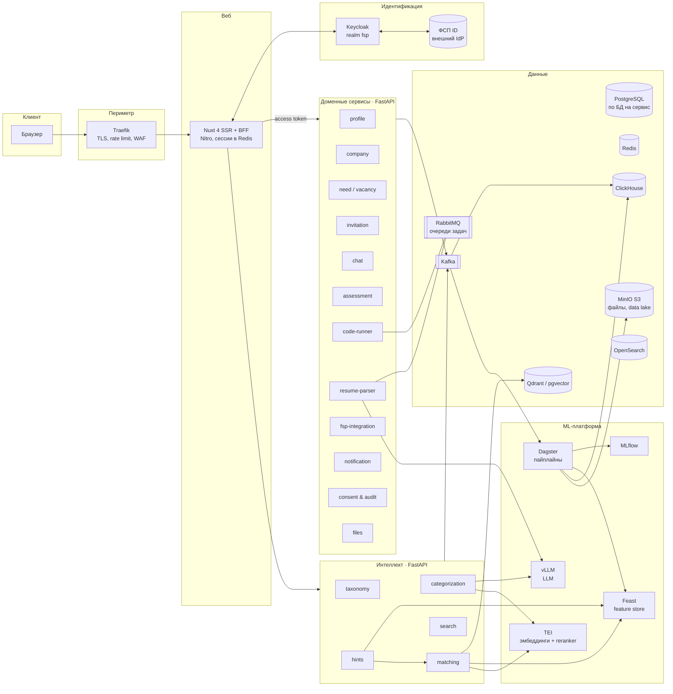
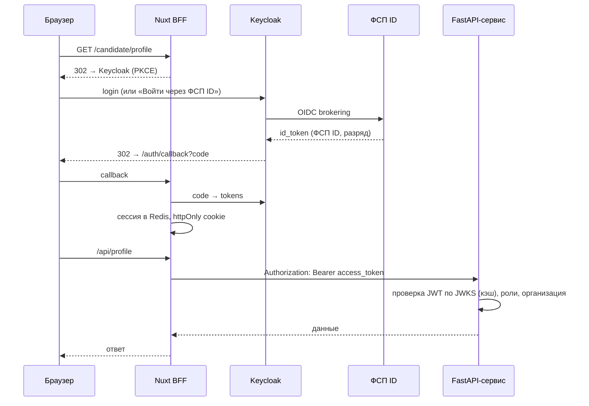
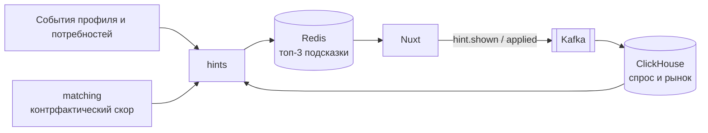
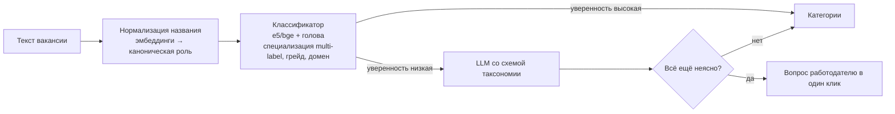
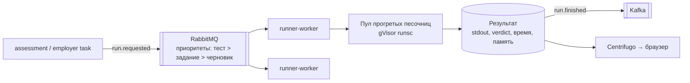

# Архитектура платформы «Карьера ФСП»

> Платформа подбора ИТ-специалистов Федерации спортивного программирования.
> Работодатель описывает потребность и получает ранжированную подборку проверенных кандидатов. Кандидат доказывает навыки тестами и достижениями ФСП и получает приглашения с вилкой.
>
> Стек: **Nuxt 4** (фронтенд и BFF), **FastAPI** (микросервисы), **Keycloak** (идентификация), **PostgreSQL**, **Kafka**, **ClickHouse**, слой ML с собственными LLM.

---

## Содержание

1. [Цели и нефункциональные требования](#1-цели-и-нефункциональные-требования)
2. [Общая схема](#2-общая-схема)
3. [Каталог сервисов](#3-каталог-сервисов)
4. [Идентификация и доступ: Keycloak](#4-идентификация-и-доступ-keycloak)
5. [Взаимодействие сервисов](#5-взаимодействие-сервисов)
6. [Данные и хранилища](#6-данные-и-хранилища)
7. [Слой ML и больших данных](#7-слой-ml-и-больших-данных)
8. [Матчинг](#8-матчинг)
9. [Подсказки для кандидата и работодателя](#9-подсказки-для-кандидата-и-работодателя)
10. [Категоризация вакансий и онтология навыков](#10-категоризация-вакансий-и-онтология-навыков)
11. [Песочница для выполнения кода](#11-песочница-для-выполнения-кода)
12. [Тестирование и грейд](#12-тестирование-и-грейд)
13. [Парсинг резюме](#13-парсинг-резюме)
14. [Безопасность и 152-ФЗ](#14-безопасность-и-152-фз)
15. [Наблюдаемость](#15-наблюдаемость)
16. [Развёртывание и масштабирование](#16-развёртывание-и-масштабирование)
17. [Структура репозитория](#17-структура-репозитория)
18. [Дорожная карта](#18-дорожная-карта)
19. [Принятые решения (ADR)](#19-принятые-решения-adr)

---

## 1. Цели и нефункциональные требования

| Требование | Цель |
|---|---|
| Масштаб | Архитектура рассчитана на 1 млн кандидатов и 50 тыс. активных потребностей без смены подхода; рост — горизонтально |
| Подборка для работодателя | p95 < 1,5 с при открытии потребности (кандидаты подготовлены заранее, онлайн только пересчёт и ранжирование) |
| Пересчёт после изменения профиля | Профиль попадает в подборки ≤ 5 мин после события |
| Выполнение кода | Очередь ≤ 3 с при нормальной нагрузке, изоляция без сетевого доступа |
| Доступность | 99,5 % для пользовательского контура; ML-контур деградирует мягко (запасная формула вместо модели) |
| Объяснимость | Каждая позиция в подборке и каждая подсказка объясняются конкретными фактами |
| Персональные данные | Хранение в РФ, раздельные согласия, решение о приглашении принимает человек (ст. 16 152-ФЗ) |
| Независимость сервисов | Своя БД на сервис, общение по контрактам (OpenAPI и схемы событий) |

**Принципы**

- **Проверенное важнее заявленного.** Тесты, задания работодателей и ФСП ID весят больше самоописания.
- **Событийная модель.** Любое изменение публикуется в Kafka, ML и аналитика питаются событиями, а не ходят в базы чужих сервисов.
- **ML отделён от транзакций.** Онлайн-сервисы работают без ML: если модели недоступны, используется запасная формула.
- **LLM только внутри контура.** Модели развёрнуты в собственной инфраструктуре; внешний API разрешён только для обезличенных данных.

---

## 2. Общая схема



**Контуры.**

- **Пользовательский:** Nuxt, доменные сервисы, PostgreSQL. Работает и без ML.
- **Интеллектуальный:** матчинг, подсказки, категоризация, поиск.
- **ML-платформа:** обучение, хранилище признаков, обслуживание моделей.
- **Данные:** Kafka как шина, ClickHouse для аналитики, MinIO как озеро данных.

---

## 3. Каталог сервисов

Каждый сервис — отдельный FastAPI-проект со своей схемой PostgreSQL, Alembic-миграциями и OpenAPI-контрактом. Общие вещи (проверка JWT, Kafka-продюсер с outbox, логирование, трассировка) вынесены в библиотеку `libs/fsp-common`.

| Сервис | Ответственность | Хранилище | Публикует события |
|---|---|---|---|
| **web (Nuxt BFF)** | SSR, OIDC-сессия, агрегация запросов для экранов | Redis (сессии) | `ui.*` (клики, показы) |
| **profile** | Профиль кандидата: условия поиска, опыт, проекты, единицы опыта, видимость | PostgreSQL | `profile.created/updated/visibility_changed` |
| **company** | Компании, команды, рекрутеры, связь с организациями Keycloak | PostgreSQL | `company.*` |
| **need** | Потребности и вакансии: требования, вилка, формат, описание задач | PostgreSQL | `need.created/updated/closed` |
| **invitation** | Приглашения, отклики, статусы (конечный автомат), раскрытие контактов | PostgreSQL | `invitation.sent/viewed/accepted/declined` |
| **chat** | Переписка после принятия, слоты интервью, этапы найма | PostgreSQL + Centrifugo (WebSocket) | `chat.message`, `hiring.stage_changed` |
| **assessment** | Опрос, адаптивный тест, банк заданий, расчёт грейда, задания работодателей | PostgreSQL | `assessment.completed`, `grade.assigned` |
| **code-runner** | Изолированное выполнение кода и проверка тестами | RabbitMQ, Redis, S3 | `run.finished` |
| **resume-parser** | PDF/DOCX → структурированный профиль с опорой на исходный текст | RabbitMQ, S3, PostgreSQL | `resume.parsed` |
| **fsp-integration** | Связь с ФСП ID, синхронизация достижений и условий кейсов | PostgreSQL | `fsp.achievement_synced` |
| **taxonomy** | Онтология навыков, ролей, доменов; синонимы; связывание | PostgreSQL + граф в памяти | `taxonomy.version_published` |
| **categorization** | Специализация, грейд и домен для потребностей и вакансий | — (модели) | `need.categorized` |
| **matching** | Отбор и ранжирование кандидатов, объяснения | Qdrant, Redis, Feast | `match.shortlist_built`, `match.impression` |
| **hints** | Подсказки «что улучшить» для обеих сторон | Redis, ClickHouse | `hint.shown/applied` |
| **search** | Полнотекстовый поиск с фасетами по банку кандидатов и вакансиям | OpenSearch | — |
| **notification** | Почта, push, Telegram; шаблоны; дайджесты | PostgreSQL | — |
| **consent & audit** | Согласия 152-ФЗ, журнал доступа к ПДн, возражения против автоматизированной обработки | PostgreSQL (append-only) | `consent.*` |
| **files** | Загрузка, антивирус ClamAV, подписанные ссылки | MinIO | `file.uploaded` |
| **admin** | Модерация компаний, жалобы, управление банком заданий | — (через API сервисов) | — |

**Почему такие границы.** Сервисы поделены по жизненному циклу сущностей: профиль, потребность, приглашение. Тяжёлые вычисления (код, парсинг, LLM) вынесены в отдельные воркеры с очередями. Им нужно другое масштабирование — CPU/GPU и автоскейлинг по длине очереди.

---

## 4. Идентификация и доступ: Keycloak

Keycloak закладывается с первого дня, даже если по ТЗ интеграция «в дальнейшем». Сервисы знают только про OIDC и JWT, поэтому позже его можно заменить или подключить внешнюю федерацию, не трогая код.

### 4.1. Модель realm `fsp`

| Сущность | Настройка |
|---|---|
| **Клиент `career-web`** | Confidential, Authorization Code + PKCE. Используется Nuxt BFF, токены не попадают в браузер |
| **Клиенты сервисов** | `svc-matching`, `svc-invitation` и т. д. — client credentials для вызовов между сервисами |
| **Realm-роли** | `candidate`, `employer`, `moderator`, `admin` |
| **Клиентские роли (company)** | `company_owner`, `recruiter`, `hiring_manager` |
| **Организации (Keycloak 26+)** | Компания = Organization. Членство и роль в компании приходят в токене (claim `organization`) |
| **Identity brokering** | **ФСП ID** как внешний OIDC-провайдер («Войти через ФСП ID»). Дополнительно — Яндекс ID и VK ID |
| **Тема** | Страницы входа в стиле бренда ФСП (Keycloakify — темы на React/Vue) |
| **Политики** | MFA (TOTP) обязательна для `employer` и `admin`; подтверждение почты; парольная политика |
| **Token exchange** | Стандартный обмен токенов (Keycloak 26.2+) для вызовов «от имени пользователя» между сервисами |

### 4.2. Вход пользователя (паттерн BFF)



- Nuxt: модуль `nuxt-oidc-auth` или `@sidebase/nuxt-auth` с провайдером Keycloak. Обновление токенов идёт на сервере, в браузере только сессионная cookie (`httpOnly`, `SameSite=Lax`).
- FastAPI: зависимость из `fsp-common` проверяет подпись (JWKS с кэшем и ротацией), `iss`, `aud`, срок действия. Из токена извлекается `Principal(sub, roles, org_id, org_roles)`.
- Права на уровне данных проверяет сам сервис. Пример: «рекрутер видит приглашения только своей организации». Keycloak отвечает на вопрос «кто это», сервис — «что ему можно».

### 4.3. Синхронизация пользователей

- Регистрация в Keycloak порождает событие в Kafka через SPI event listener (`keycloak-event-listener-kafka`) или вебхук. Сервис `profile` или `company` создаёт запись, связанную по `sub`.
- В доменных сервисах хранится только `sub` (UUID Keycloak), а не логин и пароль.
- Приглашение рекрутера в компанию: `company` вызывает Admin REST API Keycloak (добавить в Organization, выдать роль).
- Первичная привязка ФСП ID → `fsp-integration` получает `fsp_id` из claim и подтягивает достижения.

### 4.4. Если Keycloak подключается позже

На MVP можно поднять Keycloak с минимальной настройкой: один realm, вход по почте. Подключение ФСП ID, MFA и организаций потом не потребует изменений в сервисах — они уже проверяют JWT по JWKS.

---

## 5. Взаимодействие сервисов

| Тип | Технология | Где используется |
|---|---|---|
| Синхронные запросы | REST (FastAPI, OpenAPI 3.1), клиенты генерируются из контрактов | Чтение для экранов, команды пользователя |
| Горячий путь матчинга | gRPC (опционально) | `matching` ↔ `hints`, `matching` ↔ модели |
| Доменные события | **Kafka** + схемы в Apicurio/Karapace (JSON Schema) | Изменения сущностей, поток для ML и аналитики |
| Очереди задач | **RabbitMQ** (приоритеты, DLQ, подтверждения) | Выполнение кода, парсинг резюме, LLM-задачи |
| Реальное время | Centrifugo (WebSocket) | Чат, статусы приглашений, результаты прогона кода |

**Надёжная публикация событий** — паттерн Transactional Outbox. Сервис пишет событие в таблицу `outbox` в той же транзакции, что и данные. Debezium или фоновый релей переносит события в Kafka. Потребители идемпотентны (ключ `event_id`).

**Основные топики Kafka**

```
profile.events          need.events          invitation.events
assessment.events       fsp.events           resume.events
match.impressions       ui.events            hint.events
taxonomy.events         consent.events
```

Ключ партиционирования — `candidate_id` или `need_id`, чтобы сохранялся порядок событий по сущности.

---

## 6. Данные и хранилища

| Хранилище | Назначение |
|---|---|
| **PostgreSQL 16** | Отдельная БД на сервис. Профили, потребности, приглашения, тесты |
| **pgvector → Qdrant** | Эмбеддинги единиц опыта и требований. На старте pgvector, при > 5 млн векторов — Qdrant (шардирование, фильтры по payload) |
| **Redis** | Сессии BFF, кэш подборок и подсказок, онлайн-хранилище Feast, rate limit |
| **Kafka** | Шина событий и источник для ML |
| **ClickHouse** | Аналитика: показы, клики, воронка, рынок зарплат, спрос на навыки; офлайн-признаки |
| **MinIO (S3)** | Файлы (резюме, логотипы, архивы прогонов), озеро данных (Parquet/Iceberg), артефакты моделей |
| **OpenSearch** | Полнотекстовый поиск с фасетами и морфологией русского языка |

**Озеро данных.** Kafka → (Kafka Connect / Redpanda Connect) → Parquet в S3 (bronze) → очистка в Dagster (silver) → витрины признаков и аналитики (gold) в ClickHouse. При росте поверх S3 подключаются Trino и Spark.

---

## 7. Слой ML и больших данных

### 7.1. Компоненты

| Компонент | Технология | Для чего |
|---|---|---|
| Обслуживание LLM | **vLLM** + Qwen 3 (8–14B) / T-lite / T-pro, структурированный вывод (xgrammar) | Извлечение единиц опыта, парсинг резюме, LLM-судья, тексты объяснений |
| Эмбеддинги и reranker | **TEI** (text-embeddings-inference): `bge-m3`, `multilingual-e5-large`, `bge-reranker-v2-m3` | Поиск кандидатов, сравнение требований и опыта |
| Хранилище признаков | **Feast**: офлайн — ClickHouse/Parquet, онлайн — Redis | Одинаковые признаки при обучении и в онлайне |
| Оркестрация | **Dagster** | Пайплайны данных, переобучение, пакетные пересчёты |
| Реестр моделей и эксперименты | **MLflow** | Версии моделей, метрики, продвижение staging → prod |
| Классические модели | LightGBM (LambdaMART, классификация), scikit-learn | Ранжирование, P(invite), P(accept), грейд |
| Мониторинг моделей | Evidently + Grafana | Дрейф признаков, калибровка, качество |
| GPU | Отдельный пул узлов; vLLM с батчингом | LLM и эмбеддинги |

### 7.2. Пайплайны (Dagster)

| Пайплайн | Частота | Что делает |
|---|---|---|
| `evidence_extraction` | По событию `profile.updated` / `resume.parsed` | LLM извлекает единицы опыта, связывает с онтологией, считает эмбеддинги |
| `need_requirements` | По событию `need.updated` | Разбор описания потребности на требования, категоризация |
| `candidate_features` | Каждый час + по событиям | Признаки кандидатов → Feast |
| `market_stats` | Каждую ночь | Спрос на навыки, зарплаты по категориям, конкуренция → ClickHouse |
| `train_rankers` | Раз в неделю | Обучение E- и C-моделей на свежих метках, валидация, регистрация в MLflow |
| `candidate_hints` | Каждую ночь + по событиям | Подсказки для кандидатов (раздел 9) |
| `taxonomy_mining` | Раз в неделю | Новые технологии и синонимы из текстов, очередь на ручное подтверждение |
| `calibrate_items` | Раз в месяц | Калибровка параметров заданий теста (IRT) |

### 7.3. Как ML работает в онлайне

- Онлайн-сервисы не вызывают LLM синхронно на пути пользователя (исключение — подсказки по тексту потребности с задержкой ≤ 3 с). Всё тяжёлое считается заранее по событиям.
- Модели ранжирования (LightGBM) загружаются в память сервиса `matching` из MLflow: вывод за доли миллисекунды на пару.
- **Запасной режим:** если модель или feature store недоступны, используется экспертная линейная формула (раздел 8.6).

---

## 8. Матчинг

### 8.1. Идея

Подборка ранжируется по **вероятности взаимного «да»**: работодатель пригласит кандидата **и** кандидат примет приглашение. Учитывать только одну сторону недостаточно: если пять компаний пригласят одного и того же топ-кандидата, четыре получат отказ.

```
S(c, j) = P_invite(c, j) · P_accept(c, j)^α · g(load_c)
```

- `P_invite` — модель работодателя (E-модель): насколько кандидат подходит под потребность.
- `P_accept` — модель кандидата (C-модель): насколько предложение подходит кандидату.
- `α ≈ 1`, подбирается A/B-тестом. Для пассивных middle+ можно увеличить вес мотивации кандидата.
- `g(load_c) = 1 / (1 + β · открытые_приглашения_c)` — штраф за перегрузку популярных кандидатов (идея ReCon, RecSys 2023).

### 8.2. Конвейер

```mermaid
flowchart LR
  A[Потребность<br/>need.updated] --> B[Разбор требований<br/>LLM + онтология]
  B --> C[Этап 1 · Жёсткие фильтры<br/>~1М → ~20к]
  C --> D[Этап 2 · Гибридный поиск<br/>dense + sparse + BM25<br/>→ 500]
  D --> E[Этап 3 · Cross-encoder<br/>требование ↔ единица опыта]
  E --> F[Этап 4 · Признаки<br/>Feast + experience fit]
  F --> G[Этап 5 · E- и C-модели<br/>LambdaMART]
  G --> H[Этап 6 · Итоговый скор<br/>+ штраф за перегрузку]
  H --> I[Подборка + объяснения]
  I --> J[(Показы и клики<br/>→ метки для обучения)]
```



| Этап | Что происходит | Объём |
|---|---|---|
| **1. Фильтры** | Специализация (основная или смежная), грейд ±1, пересечение вилок с допуском 10–15 %, формат и город, статус «ищу / открыт», видимость, нет непокрытых обязательных требований | 1 млн → ~20 тыс. |
| **2. Поиск кандидатов** | Эмбеддинги требований → поиск ближайших единиц опыта (Qdrant с фильтром по payload) + BM25 по нормализованным навыкам; объединение (reciprocal rank fusion) | → 500 |
| **3. Cross-encoder** | Пары «требование ↔ лучшие единицы опыта» → градуированная оценка близости | 500 × ~5 × 3 пар |
| **4. Признаки** | Подтверждённые навыки, грейд, experience fit, ФСП, свежесть, зарплатный фит, формат, поведение | — |
| **5. Модели** | E-модель → `P_invite`, C-модель → `P_accept` | — |
| **6. Скор** | Формула 8.1, затем диверсификация (не больше N похожих профилей подряд) | → топ-50 |

**Когда считается.** При сохранении потребности конвейер запускается асинхронно, результат кэшируется в Redis на 1 час. Изменение профиля кандидата (событие) пересчитывает его позицию в затронутых подборках. Работодатель видит подборку мгновенно, уточнения в боковой панели применяются к кэшированному списку на 500 кандидатов.

### 8.3. Признаки

**Для E-модели (работодатель → кандидат)**

| Группа | Признаки |
|---|---|
| Навыки | Покрытие обязательных требований (с учётом trust), покрытие желательных, средний балл подтверждённых навыков, перцентиль в категории |
| Грейд | Совпадение грейда, θ из адаптивного теста, уверенность в грейде |
| Опыт | **Experience fit** (8.4), совпадение домена, масштаб, роль |
| ФСП | Наличие и уровень достижений, релевантность дисциплины требованиям |
| Свежесть | Дней с последнего задания или теста, активность за 90 дней |
| Условия | Пересечение вилки, совпадение формата |
| Поведение | Частота ответов на приглашения, средняя скорость ответа |

**Для C-модели (кандидат → предложение)**

| Группа | Признаки |
|---|---|
| Деньги | `(вилка_до − минимум_кандидата) / минимум`, позиция вилки относительно рынка категории |
| Формат | Удалёнка, гибрид, офис против предпочтения; город, релокация |
| Задачи | Близость стека и домена к «интересно» кандидата; пересечение с «не рассматриваю» |
| Компания | Аккредитация, ДМС, размер, рейтинг ответов компании |
| Процесс | Число этапов, тестовое, средний срок обратной связи (по факту из `invitation`) |
| История | Принимал ли кандидат похожие предложения, отклонял ли с причиной |

**Метки для обучения**

- E-модель: найм > интервью > приглашение > просмотр профиля > показ без действия (градуированная релевантность).
- C-модель: принял > открыл и отклонил > проигнорировал.
- Позиционное смещение компенсируется IPS-весами. В 5 % показов топ-10 немного перемешивается, чтобы получать несмещённые данные.

### 8.4. Experience fit: опыт кандидата ↔ задачи команды

Это ответ на вопрос «как наложить хакатоны и пет-проекты на то, что ищет работодатель», когда обе стороны пишут свободным текстом.

**Шаг 1. Разбор на единицы.** LLM со строгой JSON-схемой извлекает записи из текста кандидата и из текста работодателя.

```jsonc
// Единица опыта кандидата
{
  "task": "потоковый антифрод для платёжного шлюза",
  "domain": "fintech",
  "skills": ["go", "kafka", "postgresql"],      // id узлов онтологии
  "role": "owner",                              // owner | contributor | participant
  "scale": {"rps": 3000, "team": 4},
  "outcome": "2 место, хакатон ФСП 2024",
  "date": "2024-11",
  "source": "fsp_id",                           // test | employer_task | fsp_id | github | resume | self
  "evidence_span": "…сделали антифрод на Kafka, 3k rps…"   // цитата из исходного текста
}

// Требование работодателя
{
  "task": "ядро скоринга транзакций",
  "domain": "fintech",
  "skills": ["go", "kafka"],
  "scale": {"rps": 3000},
  "kind": "must",                               // must | nice
  "weight": 1.0
}
```

Поле без подтверждающей цитаты (`evidence_span`) отбрасывается. Это основная защита от выдуманных данных.

**Шаг 2. Онтология.** Навыки и домены сводятся к узлам графа (`k8s` → `kubernetes`). Близость понятий считается по расстоянию в графе.

**Шаг 3. Оценка пары «требование ↔ единица».**

```
s(r, e) = sim(r, e) · trust(e) · recency(e) · depth(r, e)
```

| Множитель | Как считается |
|---|---|
| `sim` | Эмбеддинги только отбирают пары. Финальную оценку даёт cross-encoder или LLM-судья: «доказывает ли e выполнение r: полностью 1 / частично 0,5 / нет 0». Ответы калибруются по ручной разметке (200–500 пар) |
| `trust` | Тест платформы или задание работодателя — 1,0; ФСП ID — 1,0 для навыков, которые проверяет соревнование; проверенный GitHub (авторство коммитов, не форк) — 0,8; опыт из резюме в проверяемой компании — 0,6; свободный текст — 0,35 |
| `recency` | Полураспад 2 года для фреймворков, 5 лет для фундаментальных навыков (алгоритмы, SQL, сети) |
| `depth` | Роль (owner > contributor > participant) × соответствие масштаба (100 RPS не закрывает требование 10k RPS полностью) × наличие измеримого результата |

**Шаг 4. Покрытие требования** — с убывающей отдачей (noisy-OR по трём лучшим доказательствам). Несколько независимых подтверждений лучше одного, но скор не уходит выше 1.

```
coverage(r) = 1 − Π_{e ∈ top3} (1 − s(r, e))
```

Неподтверждённые единицы (`trust < 0,5`) ограничивают покрытие обязательного требования значением 0,5: самоописание не может в одиночку пройти фильтр.

**Шаг 5. Агрегация по потребности.**

```
EF = (Π_{r ∈ must} coverage(r))^(1/n_must) · (0,7 + 0,3 · mean_{r ∈ nice} coverage(r))
```

Одно непокрытое обязательное требование резко снижает EF, желательные дают надбавку.

**Шаг 6. EF — признак для модели, а не финальный скор.** Его вес выучит LambdaMART. Для Senior и Lead EF ожидаемо самый весомый признак.

**Объяснение берётся из расчёта.** Для каждого требования сохраняется лучшая пара, отсюда текст: «Хакатон ФСП-2024: антифрод на Kafka, 3k RPS ↔ ваша задача „ядро скоринга транзакций“».

**Козырь ФСП.** `fsp-integration` подтягивает **официальные условия кейсов** хакатонов, где участвовал кандидат. Единица опыта строится из текста кейса и результата команды, а не из слов кандидата. Источник — `fsp_id`, trust 1,0.

**Защита от накруток**

- Привязка к цитате (без цитаты поле отбрасывается).
- Штраф за списки технологий без задачи и результата.
- Проверка согласованности: дата выхода технологии против даты проекта, масштаб против размера команды.
- Сверка с тестами: заявлен «эксперт Kafka», тест по Kafka слабый — trust единицы снижается.
- Поиск почти-дублей описаний (MinHash).
- Очистка входа LLM от промпт-инъекций в PDF.

### 8.5. Объяснения

- **Работодателю:** «Покрывает 3 из 3 обязательных: Go (тест — 88, 86-й перцентиль), PostgreSQL, Kafka. Похожая задача: стриминговый антифрод, 3k RPS (хакатон ФСП, подтверждено). Ожидания 250 000 ₽ — внутри вашей вилки. Не хватает: Kubernetes (желательно)».
- **Кандидату:** «280–330 тыс. ₽ — на 12 % выше вашего минимума. Удалённо, стек Go/Kafka совпадает с вашими интересами. Компания отвечает в среднем за 2 дня».
- Источник фактов — вклад признаков (SHAP по LightGBM) и сохранённые пары «требование ↔ доказательство». LLM только переписывает их в текст по шаблону и не может добавить факт, которого нет во входных данных.

### 8.6. Холодный старт: стартовые веса

Пока меток меньше нескольких тысяч приглашений, `P_invite` и `P_accept` заменяются линейными формулами. Эти же веса потом служат признаками и базовым уровнем для сравнения с моделями.

**E-скор (работодатель)**

| Признак | Intern/Junior | Middle | Senior/Lead |
|---|---|---|---|
| Покрытие обязательного стека | 25 % | 30 % | 20 % |
| Совпадение грейда (тест) | 20 % | 20 % | 15 % |
| Experience fit | 10 % | 25 % | 40 % |
| Подтверждённые баллы навыков | 20 % | 15 % | 10 % |
| Достижения ФСП | 15 % | 5 % | 3 % |
| Свежесть профиля | 10 % | 5 % | 5 % |
| Желательные навыки | — | — | 7 % |

**C-скор (кандидат):** зарплата 35 % (Senior/Lead — 40 %), формат и локация 20 %, стек и задачи 20 %, продукт и домен 10 %, бенефиты и аккредитация 10 %, качество процесса найма 5 %.

> Веса — стартовые гипотезы на основе исследования рынка (опросы hh.ru, Хабр Карьеры, Stack Overflow 2025). После накопления данных их заменяют выученные модели.

### 8.7. Метрики качества

| Уровень | Метрика |
|---|---|
| Главная | Доля взаимного принятия (принято / отправлено); взаимные совпадения на потребность за 7 дней |
| Воронка | Время до первого приглашения, время до найма, доля прошедших интервью, удержание через 90 дней |
| Офлайн | NDCG@10 для каждой стороны и для взаимного «да»; калибровка вероятностей (ECE) |
| Здоровье рынка | Джини приглашений по кандидатам (перегрузка), доля кандидатов, попавших хотя бы в одну подборку, разрывы по полу, возрасту, региону |

---

## 9. Подсказки для кандидата и работодателя

### 9.1. Принцип

Подсказка — это **контрфактический расчёт**: «что изменится, если поменять одно условие». Матчинг уже умеет считать скор для любой пары, поэтому подсказки — это его повторный прогон с изменённым входом. Тексты не пишутся вручную: система находит действия с наибольшим эффектом на единицу усилия.

```
priority(action) = Δvalue(action) / effort(action)
```

- `Δvalue` — прирост целевой метрики стороны.
- `effort` — оценка усилия: минуты на мини-тест, «одно поле», «расширить вилку».
- Показываются топ-3 по приоритету, только честные и выполнимые действия.

### 9.2. Подсказки кандидату

**Целевая метрика:** ожидаемое число приглашений за 30 дней (охват подборок × позиция × вероятность приглашения).

**Каталог действий**

| Действие | Как считается эффект | Пример текста |
|---|---|---|
| Подтвердить навык мини-тестом | Доля активных потребностей категории, где навык обязателен и кандидат проходит все остальные фильтры (блокирован только этим навыком) | «Подтвердите Kubernetes — +30 % подходящих работодателей. Мини-тест 10 мин» |
| Решить задание работодателя | Пересчёт ранга с обновлённой свежестью | «Решите задание Полярного Бита: 12 → 7 место в категории» |
| Связать ФСП ID | Пересчёт E-скора с достижениями | «Свяжите ФСП ID — подтянутся 2 достижения» |
| Добавить GitHub / проект | Прирост EF при trust 0,8 вместо 0,35 для существующих единиц | «Добавьте GitHub — +18 % просмотров профиля» |
| Детализировать проект | Требования, которые единица покрывает частично из-за отсутствия масштаба или роли | «Укажите нагрузку в проекте „Антифрод“ — он совпадёт с 14 потребностями» |
| Расширить формат | Число потребностей, отсечённых только по формату | «Рассмотрите гибрид в Новосибирске: +9 компаний» |
| Зарплатные ожидания | Число потребностей, отсечённых только по вилке, и рыночный перцентиль | «Ваш минимум выше 85 % вилок категории — 11 компаний отсекают вас по деньгам» |
| Повысить грейд | Если θ близко к границе грейда и с прошлого теста прошло больше 3 месяцев | «До Senior не хватает 6 баллов — тест доступен с 10 января» |

**Как считается**

1. **Ночной пакетный расчёт (Dagster):** спрос по категории из ClickHouse — частота требований, их обязательность, вилки, форматы.
2. **Поиск «почти прошёл»:** для каждого кандидата — потребности, где он отсечён ровно одним фильтром. Это самый дешёвый и сильный сигнал.
3. **Пересчёт моделью:** признаки кандидата меняются на контрфактические (`kubernetes.trust = 1`, `freshness = 0`) и пересчитываются ранги по выборке потребностей. LightGBM работает быстро, на кандидата уходят миллисекунды.
4. **Кэш:** результат кладётся в Redis. Событие профиля (`profile.updated`, `assessment.completed`) пересчитывает подсказки кандидата за секунды.

### 9.3. Подсказки работодателю

**Целевая метрика:** ожидаемое число взаимных совпадений `Σ P_invite · P_accept` по подборке, а также средняя релевантность топ-10.

**Каталог действий**

| Действие | Как считается эффект | Пример текста |
|---|---|---|
| **Сузить** — сделать навык обязательным и подтверждённым | Размер пула и средняя релевантность до и после | «Kafka — только подтверждённая тестом: 24 → 9, соответствие 89 % → 95 %» |
| Добавить требование домена | То же | «Опыт в финтехе от 1 года: 24 → 11» |
| Фильтр активности | То же + рост `P_accept` | «Активен в последние 14 дней: 24 → 13, принимают вдвое чаще» |
| **Расширить** — снять обязательное требование | Прирост пула при допустимом падении релевантности | «Уберите обязательный Kubernetes: +40 кандидатов, соответствие −2 %» |
| Поднять вилку | Прирост `P_accept` по C-модели, рыночный перцентиль | «Вилка ниже медианы категории: до 300 000 ₽ — принятие приглашений +22 %» |
| Разрешить удалёнку или гибрид | Прирост пула и `P_accept` | «Разрешите удалёнку: ×3 кандидата» |
| Описать задачи команды | Проверка полноты текста LLM: нет задач, масштаба, стека | «Опишите, что человек будет делать первые 3 месяца — точность подборки вырастет» |
| Сократить обязательные навыки | Если обязательных > 5 | «7 обязательных навыков: под все подходит 2 кандидата. Оставьте 3–5 главных» |

**Как считается**

1. Подборка на 500 кандидатов уже в кэше со всеми признаками. Сужение считается фасетными подсчётами по этому множеству (битовые маски в памяти) за десятки миллисекунд.
2. Расширение (снять фильтр) — один дополнительный запрос к этапу 1 без этого фильтра. Он идёт фоново и кэшируется.
3. Вилка и формат — пересчёт `P_accept` C-моделью с изменённым признаком.
4. Текст описания — LLM-проверка по чек-листу при сохранении потребности (с задержкой, асинхронно).
5. Применение подсказки — одна кнопка. Исходная подборка сохраняется, уточнение можно снять.

### 9.4. Честность и обучение подсказок

- Подсказки не предлагают приукрашивать. Каждая ведёт к проверяемому действию (тест, задание, ссылка) или к осознанному изменению условий.
- Зарплатные подсказки показывают рыночные факты, а не давят: «ваш минимум выше 85 % вилок».
- События `hint.shown` и `hint.applied` и последующий результат (приглашения, принятия) пишутся в ClickHouse.
- Выбор типов подсказок — контекстный многорукий бандит (Thompson sampling): какие подсказки реально приводят к результату для данной категории и грейда.



---

## 10. Категоризация вакансий и онтология навыков

### 10.1. Онтология (`taxonomy`)

| Ось | Источник |
|---|---|
| Специализация | ~20–25 ИТ-ролей, сопоставление с professional_roles hh.ru для совместимости выгрузок |
| Грейд | Intern, Junior, Middle, Senior, Lead |
| Домен | Отраслевой справочник (финтех, e-commerce, госсектор, БАС, ИБ…) |
| Навыки | Собственный граф технологий (ESCO — для многоязычных меток, профстандарты — для нормативных выгрузок); связи `is_a`, `related`, `requires` |

- Синонимы и варианты написания: словарь + эмбеддинги + LLM для неоднозначных случаев.
- Новые технологии `taxonomy_mining` находит в текстах и отправляет модератору. Версии онтологии публикуются событием `taxonomy.version_published`, сервисы перезагружают её без простоя.

### 10.2. Категоризация потребностей и вакансий (`categorization`)



- Одна основная специализация + до двух смежных. Грейд — распределение вероятностей.
- Грейд не равен «годам опыта»: учитываются название (Senior, Lead, «ведущий»), ответственность (архитектура, менторство), вилка, требуемый стаж.
- Слабая разметка для обучения — открытые вакансии с проставленными ролями и опытом, затем ручная проверка выборки.
- Итоговую категорию подтверждает работодатель в форме потребности.

---

## 11. Песочница для выполнения кода

### 11.1. Схема



### 11.2. Изоляция

| Уровень | Мера |
|---|---|
| Ядро | gVisor (`runsc`) — пользовательский код не обращается к ядру хоста напрямую. Для максимальной изоляции — Firecracker microVM |
| Внутри | nsjail или isolate: seccomp, cgroups v2, отдельные namespaces |
| Сеть | Полностью отключена (`--network none`) |
| Ресурсы | CPU-квота, память (256–512 МБ), PID-лимит, время (wall и CPU), размер вывода |
| Файловая система | Корень только для чтения, tmpfs для рабочей директории, очистка после прогона |
| Образы | Отдельный минимальный образ на язык (Go, Python, Java, C++, JS, Rust), подписаны и просканированы |
| Пользователь | Без root, без capabilities |
| Узлы | Отдельный пул узлов только для runner, без доступа к внутренней сети платформы |

### 11.3. Проверка

- Скрытые тесты, чекер с допусками для вещественных ответов, интерактивные задачи.
- **Уникальные варианты:** параметры задачи (числа, имена, ограничения) генерируются под кандидата из шаблона. Готовые ответы не помогают.
- **Антиплагиат:** токенное и AST-сходство (подход JPlag) между решениями одного задания, сигнал для модератора.
- Масштабирование воркеров — KEDA по длине очереди.
- Альтернатива для MVP: развернуть self-hosted Judge0 за тем же интерфейсом очереди и потом заменить его своим runner.

---

## 12. Тестирование и грейд

Как работает реализованный адаптивный тест (банк, EAP, выбор заданий, остановка, решение по грейду, баллы по навыкам) — в [`docs/GRADE_TEST.md`](docs/GRADE_TEST.md).

- **Опрос:** отрасль → специализация → предполагаемый грейд → стек. Определяет набор заданий.
- **Адаптивный тест (CAT)** на основе IRT (модель 2PL/3PL):
  - каждое задание откалибровано — сложность, различительная способность;
  - следующее задание выбирается по максимуму информации при текущей оценке θ;
  - тест останавливается при достижении точности или по лимиту заданий.
- **Грейд** определяется порогами θ на шкале специализации. Пороги калибруются по выборке с известным грейдом.
- **Правила ТЗ:** грейд не понижается; при неудаче предлагается уровень ниже; повышение — не чаще раза в 3 месяца.
- **Задания работодателей** — короткие задачи, которые поддерживают свежесть профиля и дают компании собственный сигнал.
- Баллы по навыкам (Go 88, PostgreSQL 81…) — это θ по подшкалам. Они идут в профиль и в признаки матчинга с `trust = 1`.

---

## 13. Парсинг резюме

```mermaid
flowchart LR
  U[Загрузка PDF/DOCX] --> F[files<br/>ClamAV, S3]
  F -->|resume.uploaded| Q[[RabbitMQ]]
  Q --> X[Извлечение текста<br/>PyMuPDF / python-docx<br/>OCR: PaddleOCR / Tesseract rus]
  X --> L[Разметка блоков<br/>опыт, образование, навыки, проекты]
  L --> E[LLM-извлечение<br/>JSON-схема + цитаты]
  E --> N[Нормализация<br/>онтология, даты, компании]
  N --> V[Оценки уверенности]
  V --> UI[Кандидат подтверждает и правит]
  UI -->|resume.parsed| K[[Kafka]] --> EV[evidence_extraction]
```



- Структурированный вывод vLLM (грамматика по JSON-схеме): модель не может вернуть невалидную структуру.
- Каждое поле хранит цитату-источник и уверенность. Поля с низкой уверенностью подсвечиваются в форме подтверждения.
- Контакты (телефон, почта) сразу уходят в защищённое хранилище ПДн, в аналитику и ML попадает обезличенный профиль.
- Навыки из резюме получают `source = resume` (trust 0,6) до подтверждения тестом.
- Защита: лимит размера и числа страниц, очистка скрытого текста и промпт-инъекций (белый текст, мелкий шрифт), таймауты.

---

## 14. Безопасность и 152-ФЗ

| Тема | Решение |
|---|---|
| Локализация | Все ПДн и инфраструктура — в РФ |
| Разделение ПДн | Контакты и паспортные данные (если появятся) — в отдельном сервисе с шифрованием на уровне полей (Vault Transit). Остальные сервисы работают с псевдонимизированным `candidate_id` |
| Согласия | `consent`: отдельные согласия на обработку, на публикацию профиля работодателям, на рассылки. Отзыв согласия → событие → профиль скрывается из подборок |
| Автоматизированные решения (ст. 16) | Подборка — рекомендация, решение о приглашении принимает человек. Отсечение фильтром показывается как «скрыт фильтром, можно раскрыть». Объяснение ранжирования доступно кандидату. Возражение рассматривается в течение 30 дней |
| Раскрытие контактов | Только после принятия приглашения или собственного отклика (конечный автомат `invitation`) |
| Аудит | Журнал всех обращений к ПДн (кто, когда, зачем) в append-only хранилище |
| Предвзятость | Из признаков исключены пол, возраст, фото, имя и прокси (год выпуска, перерывы в стаже). Регулярный аудит долей приглашений по группам |
| Секреты | Vault / Sealed Secrets, ротация ключей |
| Периметр | Traefik: TLS 1.3, rate limit, WAF (Coraza); защита от ботов на регистрации |
| Сервис-сервис | mTLS (service mesh — Linkerd на этапе Kubernetes) + токены client credentials |
| Ориентир | Требования EU AI Act к системам найма (документация, надзор человека, логирование) — как чек-лист зрелости |

---

## 15. Наблюдаемость

- **Трассировка:** OpenTelemetry во всех сервисах (FastAPI, Nuxt/Nitro), сбор в Tempo. Сквозной `trace_id` от браузера до Kafka-потребителей.
- **Метрики:** Prometheus + Grafana. Технические (RED, длина очередей, лаг потребителей Kafka) и продуктовые (доля взаимного принятия, конверсия подсказок).
- **Логи:** структурированный JSON → Loki.
- **Ошибки:** Sentry (фронтенд и бэкенд).
- **ML:** Evidently — дрейф признаков, калибровка, NDCG на свежих данных. Алерт при деградации переключает на предыдущую версию модели.

---

## 16. Развёртывание и масштабирование

### 16.1. Этапы

| Этап | Инфраструктура |
|---|---|
| **MVP (чемпионат)** | Docker Compose + Traefik на 1–3 серверах. PostgreSQL, Redis, Kafka (KRaft, 1 брокер), MinIO, Keycloak, один GPU-сервер для vLLM/TEI |
| **v1** | Kubernetes, Helm-чарты, ArgoCD (GitOps). Managed PostgreSQL или CloudNativePG. Kafka — Strimzi (3 брокера). Отдельный GPU-пул |
| **v2** | Несколько зон, ClickHouse-кластер, Qdrant-кластер, Trino/Spark над озером данных |

### 16.2. Как масштабируется

- **Stateless-сервисы** (FastAPI, Nuxt) — HPA по CPU и RPS.
- **Воркеры** (runner, парсинг, LLM-задачи) — KEDA по длине очереди RabbitMQ и лагу Kafka.
- **LLM** — vLLM с непрерывным батчингом; маленькие модели для массовых задач (извлечение), большие — для сложных (судья).
- **Матчинг** — подборки предрасчитаны и кэшированы; онлайн только переранжирование 500 кандидатов.
- **PostgreSQL** — реплики для чтения; при росте — партиционирование событийных таблиц по времени.
- **Kafka** — масштабирование числом партиций, ключи по сущностям.

### 16.3. CI/CD

GitLab CI:

1. Линтеры: ruff, mypy, eslint.
2. Тесты: pytest, vitest, Playwright.
3. Проверка контрактов: изменения OpenAPI и схем событий не должны ломать потребителей.
4. Сборка образов и сканирование: Trivy.
5. Деплой на stage, затем на prod через ArgoCD.

Модели проходят свою цепочку в MLflow: офлайн-валидация → shadow-режим → A/B → prod.

---

## 17. Структура репозитория

Монорепозиторий: проще синхронизировать контракты и общую библиотеку.

```
fsp-career/
├── apps/
│   └── web/                      # Nuxt 4 (текущий прототип)
├── services/
│   ├── profile/                  # FastAPI: app/, alembic/, tests/, Dockerfile
│   ├── company/
│   ├── need/
│   ├── invitation/
│   ├── chat/
│   ├── assessment/
│   ├── code-runner/
│   ├── resume-parser/
│   ├── fsp-integration/
│   ├── taxonomy/
│   ├── categorization/
│   ├── matching/
│   ├── hints/
│   ├── search/
│   ├── notification/
│   ├── consent/
│   └── files/
├── ml/
│   ├── pipelines/                # Dagster: assets, jobs, schedules
│   ├── features/                 # Feast: определения признаков
│   ├── training/                 # обучение рейтеров, классификаторов, IRT
│   └── prompts/                  # промпты и JSON-схемы извлечения (версионируются)
├── libs/
│   └── fsp-common/               # auth (JWT/JWKS), outbox, kafka, logging, otel, errors
├── contracts/
│   ├── openapi/                  # контракты сервисов
│   └── events/                   # JSON Schema событий
├── infra/
│   ├── compose/                  # docker-compose для локальной разработки и MVP
│   ├── helm/                     # чарты
│   ├── keycloak/                 # realm-export.json, тема (Keycloakify)
│   └── argocd/
└── docs/
    ├── ARCHITECTURE.md
    └── adr/                      # решения по архитектуре
```

**Шаблон FastAPI-сервиса:** `app/api` (роутеры), `app/domain` (модели и логика), `app/infra` (репозитории SQLAlchemy 2.0 async, outbox, клиенты), `app/settings.py` (pydantic-settings), `/health` и `/ready`, метрики `/metrics`.

---

## 18. Дорожная карта

| Этап | Что входит |
|---|---|
| **MVP — к защите кейса** | Nuxt + 6 сервисов: profile, company, need, invitation, assessment (неадаптивный тест), resume-parser. Keycloak (почта + ФСП ID-заглушка). Матчинг — фильтры + гибридный поиск + линейная формула 8.6 + experience fit. Подсказки «почти прошёл». Judge0 как песочница |
| **v1** | Свой code-runner на gVisor, адаптивный тест (IRT), чат, Kafka + ClickHouse, обучение E/C-моделей LambdaMART, контрфактические подсказки, категоризация с классификатором, реальный ФСП ID и условия кейсов |
| **v2** | Борьба с перегрузкой через оптимальный транспорт, бандит для подсказок, Qdrant-кластер, озеро данных с Trino, аудит справедливости, LLM-судья для разметки |

---

## 19. Принятые решения (ADR)

| # | Решение | Почему | Альтернатива |
|---|---|---|---|
| 1 | Микросервисы на FastAPI | Async, Pydantic-контракты, единый язык с ML | Модульный монолит — разумен для первых недель MVP: границы модулей те же, разнести их позже можно без переписывания |
| 2 | Nuxt как BFF | Токены не попадают в браузер, агрегация данных для экранов, SSR | Отдельный API-gateway на FastAPI |
| 3 | Keycloak с первого дня | Организации для компаний, брокеринг ФСП ID, MFA, стандарт OIDC | Своя авторизация — дороже и опаснее |
| 4 | Kafka для событий, RabbitMQ для задач | Kafka — переигрываемый поток для ML и аналитики; RabbitMQ — подтверждения, приоритеты, DLQ для тяжёлых задач | Только Kafka (сложнее с приоритетами задач) |
| 5 | LLM внутри контура (vLLM) | ПДн по 152-ФЗ, предсказуемая стоимость | Внешний API — только для обезличенных задач |
| 6 | Ранжирование по взаимному «да» | Одностороннее ранжирование перегружает топ-кандидатов и снижает долю принятых приглашений | Только релевантность для работодателя |
| 7 | pgvector → Qdrant | Простой старт в PostgreSQL, переход при росте | Qdrant с первого дня |
| 8 | gVisor для песочницы | Изоляция ядра без накладных расходов полноценной VM | Firecracker (сильнее изоляция, сложнее эксплуатация) |
| 9 | Подсказки как контрфактический расчёт | Честные цифры из той же модели, что ранжирует; автоматическое покрытие новых навыков | Ручные правила и тексты |
