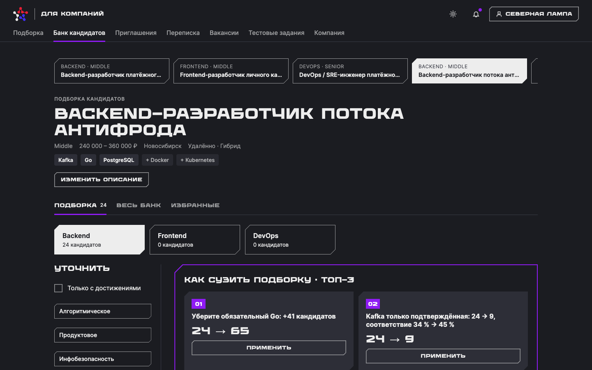
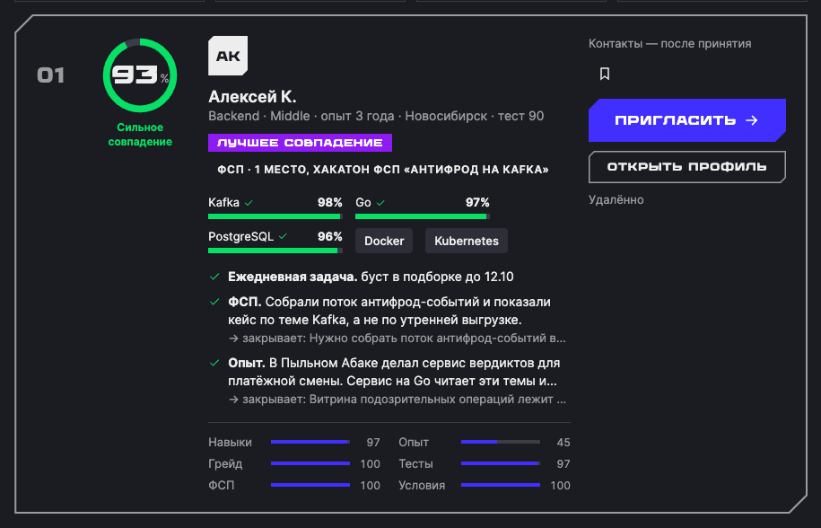
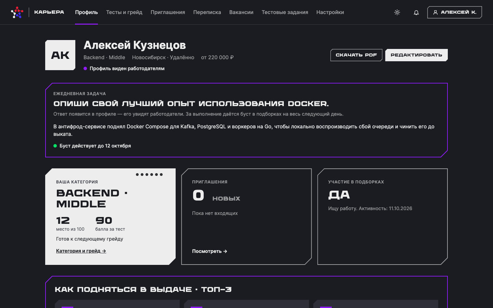
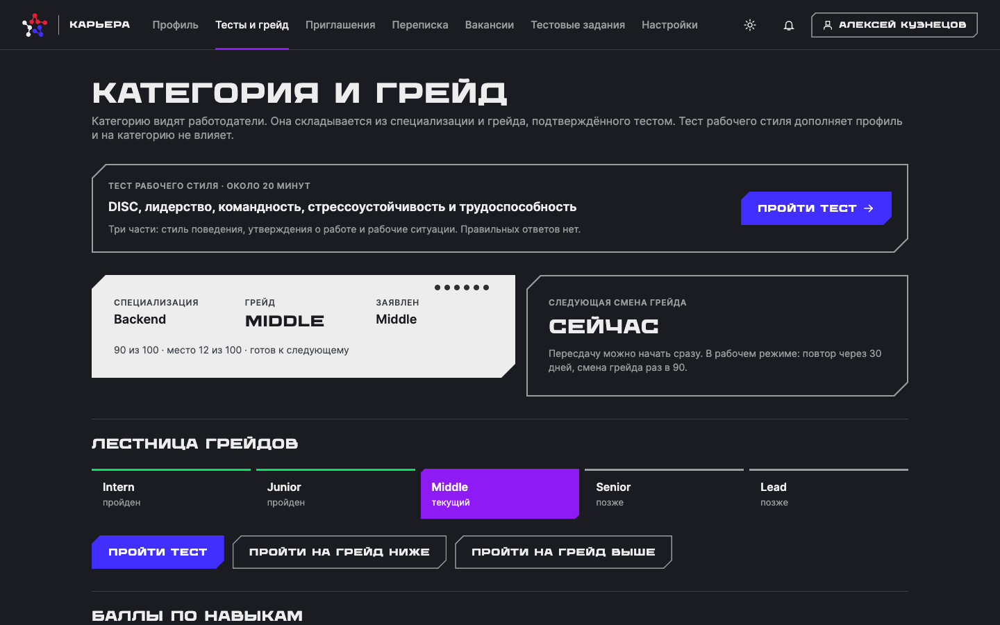
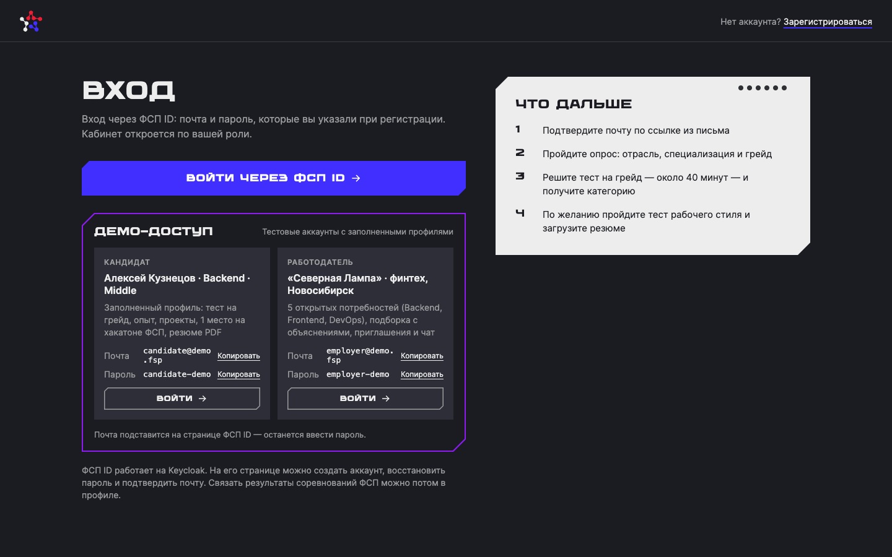
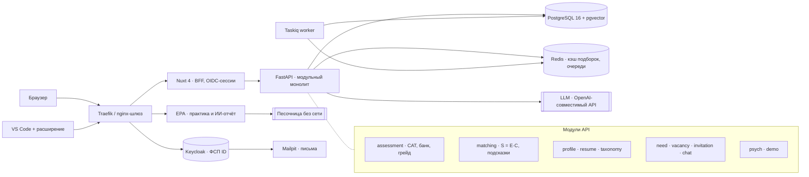

# Карьера ФСП

> Платформа **обратного подбора** ИТ-специалистов для Федерации спортивного программирования. Кандидат подтверждает навыки адаптивным тестом и достижениями ФСП. Работодатель описывает задачу и за секунды получает объяснимую подборку, а затем сам приглашает кандидатов с вилкой зарплаты.

Команда **YAKUBO DIGITAL** · спецтрек ФСП · [презентация](1_Карьера_ФСП_YAKUBO_DIGITAL.pdf)



---

## Содержание

1. [Коротко для жюри](#коротко-для-жюри)
2. [Демо за 5 минут](#демо-за-5-минут)
3. [Как это работает](#как-это-работает)
4. [Соответствие ТЗ](#соответствие-тз)
5. [Запуск](#запуск)
6. [Архитектура и стек](#архитектура-и-стек)
7. [Структура репозитория](#структура-репозитория)
8. [Ограничения MVP и план развития](#ограничения-mvp-и-план-развития)
9. [Команда](#команда)

---

## Коротко для жюри

| | Что сделано | Почему это важно |
|---|---|---|
| 🎯 **Категорию определяет тест, а не резюме** | Адаптивный тест (CAT, IRT 2PL) на банке из **288 параметризованных шаблонов**, 7 форматов: MCQ, MSQ, SHORT, CODE, DEBUG, REVIEW, CASE | У каждого кандидата свои варианты заданий, поэтому утёкшие ответы бесполезны. Результаты сопоставимы между кандидатами на единой шкале θ |
| 📈 **Точность теста подтверждена** | Симуляция на 2000 кандидатах на специализацию: **84–86 %** точность грейда, **0 %** ошибок больше чем на один грейд, **87–91 %** тот же грейд при повторе, корреляция с истинным уровнем **0,96** | Это цифры, а не обещания: `services/api/.venv/bin/python tmp_bank/sim.py tmp_bank/bank.json` |
| ⚖️ **Подбор с двух сторон** | `S = E · C^α / (1 + β · открытые приглашения)`: E — подходит ли кандидат работодателю, C — подходит ли предложение кандидату, β — штраф за перегрузку приглашениями | Приглашения не уходят одним и тем же людям, а кандидат получает предложения, которые готов принять |
| 🏆 **Ранжирование лучше бейзлайна** | **NDCG@10 = 0,936** против **0,526** у сортировки по совпадению навыков; формула выигрывает в **10 из 10** потребностей ручного эталона | Качество проверено на эталоне, рубрика которого не зависит от формулы: `services/api/.venv/bin/python eval/run.py` |
| 💬 **Объяснимость** | У каждого кандидата есть процент совпадения, покрытие каждого обязательного навыка, разбивка скора (навыки / опыт / грейд / тесты / ФСП / условия) и 2–3 причины со ссылкой на факт из опыта | Работодатель понимает, почему кандидат в топе. Решение о приглашении принимает человек |
| 🛠 **Практика с ИИ-проверкой** | Работодатель прикладывает к приглашению реальное задание. Кандидат решает его в VS Code, код проверяется тестами в песочнице без сети, ИИ строит отчёт по **8 измерениям** с доказательствами | Вместо ручного код-ревью работодатель получает разбор решения ещё до оффера |
| 🥇 **Достижения ФСП — карьерный сигнал** | Победы на соревнованиях ФСП повышают покрытие навыков и скор, в выдаче показывается бейдж с местом | Платформа решает задачу федерации: спортивное программирование превращается в карьеру |
| 🚀 **Кандидат знает, как подняться** | Топ-3 подсказки с числовым эффектом, задание дня с бустом в подборке, роадмап самопроверки, вилка видна до общения | Профиль растёт, а не устаревает |
| 🔒 **152-ФЗ и приватность** | Контакты раскрываются только после принятия приглашения (проверяется на сервере); настройки приватности применяются в выдаче; пол, возраст, фото и имя не участвуют в скоринге | Закладка под реальные персональные данные |
| 🐳 **Запуск одной командой** | `make up` — и демо-данные поднимаются сами. Для облака есть готовый `docker-compose.coolify.yml` | Стенд разворачивается за минуты |

---

## Демо за 5 минут

Демо-аккаунты есть на странице входа `/auth` (кнопки «Копировать» и «Войти»):

| Роль | Почта | Пароль | Что внутри |
|---|---|---|---|
| Кандидат | `candidate@demo.fsp` | `candidate-demo` | Алексей Кузнецов, Backend · Middle: тест на грейд, опыт, проекты, 1 место на хакатоне ФСП, резюме PDF |
| Работодатель | `employer@demo.fsp` | `employer-demo` | «Северная Лампа», финтех: 5 открытых потребностей (Backend, Frontend, DevOps), приглашения и чат |

На платформе **400 кандидатов** по 4 специализациям и 5 грейдам, **15 компаний**, **28 потребностей**, **80 приглашений** — все данные синтетические.

**Сценарий показа**

1. **Работодатель** → «Подборка». Переключаемся между вакансиями компании. На «Backend-разработчик потока антифрода» первым стоит Алексей К. с совпадением 93 %, бейджем ФСП и покрытием Kafka / Go / PostgreSQL. Смотрим причины и разбивку скора.
2. Применяем подсказку «Как сузить подборку» и видим, как меняется выдача.
3. «Открыть профиль» → «Пригласить»: вилка обязательна, контакты скрыты до принятия.
4. **Кандидат** → «Профиль»: категория, место в категории, навыки с баллами теста, достижения ФСП, подсказки «Как подняться в выдаче».
5. «Тесты и грейд» → адаптивный тест: задания подбираются под текущую оценку уровня, грейд определяется с учётом погрешности.
6. «Приглашения» → принять → у работодателя открываются контакты и чат.

<table>
<tr>
<td width="50%"><br><sub>Карточка в подборке: совпадение, покрытие навыков, причины, разбивка скора</sub></td>
<td width="50%"><br><sub>Профиль кандидата: категория, задание дня, подсказки, навыки и ФСП</sub></td>
</tr>
<tr>
<td><br><sub>Категория и грейд: лестница грейдов, тест на грейд выше или ниже</sub></td>
<td><br><sub>Вход через ФСП ID (Keycloak) с демо-доступом</sub></td>
</tr>
</table>

---

## Как это работает

### Путь кандидата

```
Опрос по специализации → самовыбор грейда → адаптивный тест → категория «специализация × грейд»
        → профиль (опыт, проекты, резюме PDF, ФСП) → подборки работодателей → приглашение с вилкой → контакты и чат
```

### Тест на грейд

| Механизм | Как устроено |
|---|---|
| **Параметризованные шаблоны** | Генератор подставляет параметры: структура задания и ловушка те же, правильный ответ другой. Чужой ответ бесполезен |
| **Калибровка IRT 2PL** | У шаблона есть сложность `b` и различающая сила `a` на единой шкале θ, поэтому результаты разных кандидатов сопоставимы |
| **Адаптивный подбор (CAT)** | Следующее задание — самое информативное для текущей оценки. Тест останавливается при SE < 0,30; один шаблон попадает не более чем в 25 % тестов |
| **Решение по грейду** | Пороги θ: Junior / Middle / Senior. Без принудительного понижения: предлагается тест на грейд ниже или выше. Смена грейда — не чаще раза в 90 дней, повтор того же теста — через 30 |

Банк заданий и симуляция лежат в [`tmp_bank/`](tmp_bank/), движок — в `services/api/app/assessment` (`cat_engine`, `item_bank`, `cat_service`). Подробности — [docs/GRADE_TEST.md](docs/GRADE_TEST.md).

### Подбор

**E — подходит ли кандидат работодателю:** покрытие обязательных навыков (тест > ФСП > резюме и проекты), совпадение грейда, experience fit (опыт кандидата ↔ задачи команды), средний балл теста, достижения ФСП, свежесть профиля. Если обязательный навык покрыт меньше чем на 0,3, кандидат уходит в «скрыт фильтром».

**C — подходит ли предложение кандидату:** вилка относительно минимума кандидата, формат работы, интерес к стеку, домен, бенефиты, число этапов найма.

Веса зависят от грейда: для Junior важнее тест и ФСП, для Senior — опыт в задачах команды (40 % E-скора). Все веса собраны в одном месте: `services/api/app/matching/config.py`.

### Практика с ИИ-проверкой

1. Работодатель загружает проект (zip) и ТЗ, ставит дедлайн.
2. Задание прикрепляется к приглашению и становится видно после принятия.
3. Кандидат работает в VS Code: расширение передаёт ход работы только по папке задания, сдача — через git.
4. Снимок кода → тесты в песочнице без сети → ИИ-разбор.
5. Отчёт по 8 измерениям (качество кода, архитектура, безопасность, знание технологий, отладка, реакция на ревью, объяснение решения, адаптивность). Каждый балл опирается на факт; нет фактов — измерение пустое, а не ноль. Итог — рекомендация, решение остаётся за работодателем.

### Улучшение профиля

- **Подсказки:** топ-3 действия с числовым эффектом — мини-тест, проект, условия.
- **Задание дня:** короткий рассказ о навыке попадает в профиль и даёт буст в подборках на следующий день.
- **Роадмап:** самопроверка по темам roadmap.sh показывает пробелы.
- **Подтверждение навыков:** тест на грейд выше, микрозадания, ФСП ID, проекты. Доверие к навыку растёт с 0,35 до 1,0.
- **Тест рабочего стиля** (по желанию): DISC, утверждения, рабочие ситуации. На категорию не влияет — [docs/PSYCH_TEST.md](docs/PSYCH_TEST.md).

---

## Соответствие ТЗ

| Требование ТЗ ФСП | Как закрыто |
|---|---|
| «Единый набор заданий утечёт» | У каждого кандидата свои варианты из параметризованных шаблонов |
| «LLM не гарантирует сопоставимость» | Сложность задаёт откалиброванный шаблон (IRT), а не генерация |
| «Код, опросники, иные форматы» | 7 форматов; код проверяется скрытыми тестами в песочнице |
| «Не понижать грейд принудительно» | Тест на грейд ниже или выше, решение с учётом погрешности |
| «Ограничить смену грейда» | Не чаще раза в 90 дней, повтор того же теста — через 30 |
| Выдача по категориям | Плитки категорий, фильтры не теряют подборку, вилка обязательна |
| Объяснимость подборки | 2–3 причины со ссылкой на факт, разбивка скора по признакам |
| Приватность | Контакты — только после принятия приглашения |
| Авторизация | Keycloak (OIDC, PKCE), роли «кандидат» и «работодатель», подтверждение почты |

Полное ТЗ на MVP — [docs/MVP_TZ.md](docs/MVP_TZ.md).

---

## Запуск

### Локально

Нужен Docker с Compose v2.

```bash
make up
```

Поднимаются web, api, worker, postgres (pgvector), redis, keycloak, mailpit, epa и piston. **API при старте сам применяет миграции и загружает демо-данные**, так что `make migrate` и `make seed` вручную не нужны.

| Адрес | Что |
|---|---|
| http://localhost | Приложение |
| http://localhost/auth | ФСП ID (Keycloak) |
| http://localhost/mail | Письма подтверждения почты (Mailpit) |

Режим загрузки демо-данных задаётся переменной `SEED_ON_START`:

| Значение | Поведение |
|---|---|
| `if-empty` (по умолчанию локально) | Загрузить только в пустую базу |
| `always` (по умолчанию в Coolify) | Возвращать демо в исходное состояние при каждом старте API |
| `off` | Не трогать данные |

Полезные команды: `make migrate`, `make seed` (пересев вручную), `make logs`, `make reset` (с нуля, включая реалм Keycloak).

Фронтенд без бэкенда, на моках: `cd apps/web && NUXT_PUBLIC_API_MOCKS=1 npm run dev`.

### Деплой в Coolify

В корне лежит готовый [`docker-compose.coolify.yml`](docker-compose.coolify.yml): production-сборка веба, собственный шлюз на nginx, реалм Keycloak и демо-данные встроены в образы.

1. New Resource → репозиторий → Build Pack **Docker Compose**, Docker Compose Location: `/docker-compose.coolify.yml`.
2. Домен назначить **только сервису `gateway`**, например `https://fsp-demo.example.ru`.
3. Переменная окружения `PUBLIC_URL` — тот же адрес без слэша в конце.
4. Deploy. Миграции и демо-данные применятся автоматически.

Серверу нужно около 4 ГБ памяти. После смены `PUBLIC_URL` нужен Redeploy с пересборкой. Админка Keycloak наружу не публикуется.

### Основные переменные

| Переменная | По умолчанию | Назначение |
|---|---|---|
| `PUBLIC_URL` | `http://localhost` | Публичный адрес стенда (Coolify) |
| `SEED_ON_START` | `if-empty` / `always` | Загрузка демо-данных при старте API |
| `LLM_ENABLED`, `LLM_BASE_URL`, `LLM_API_KEY`, `LLM_MODEL` | `false` | OpenAI-совместимый LLM для разбора резюме и описаний задач |
| `MATCH_ALPHA`, `MATCH_BETA` | `1.0`, `0.15` | Степень C и штраф за открытые приглашения в формуле подбора |
| `ASSESSMENT_COOLDOWN` | `off` | Ограничения пересдачи теста (для показа выключены) |
| `DEEPSEEK_API_KEY`, `OLLAMA_URL` | — | Модель для ИИ-отчёта по практике |

### Проверки

```bash
make venv                                              # окружение API (uv, Python 3.12)
scripts/ci.sh                                          # ruff, mypy, import-linter, pytest, eslint
services/api/.venv/bin/python eval/run.py              # NDCG@10 подбора против бейзлайна
services/api/.venv/bin/python tmp_bank/sim.py tmp_bank/bank.json   # симуляция теста (~2 мин)
cd apps/web && npx vue-tsc --noEmit && npm run build   # типы и сборка фронтенда
```

---

## Архитектура и стек

Модульный монолит: границы модулей совпадают с будущими микросервисами, импорт между модулями идёт только через публичный интерфейс (проверяется import-linter).



| Слой | Технологии |
|---|---|
| Фронтенд | Nuxt 4, Vue 3, TypeScript, nuxt-oidc-auth, Monaco Editor; адаптивная вёрстка, светлая и тёмная тема |
| Бэкенд | Python 3.12, FastAPI, Pydantic v2, SQLAlchemy 2 (async), Alembic, Taskiq |
| Данные | PostgreSQL 16 + pgvector, Redis 7 |
| Авторизация | Keycloak 26 (OIDC, PKCE, realm roles) |
| Тест | IRT 2PL, EAP-оценка θ, CAT с контролем экспозиции |
| Практика | EPA: TypeScript-сервис, расширение VS Code, песочница, LLM (Ollama / Qwen или DeepSeek) |
| Инфраструктура | Docker Compose, Traefik, Coolify |

Целевая архитектура — [docs/ARCHITECTURE.md](docs/ARCHITECTURE.md).

---

## Структура репозитория

```
apps/web/              Nuxt 4: кабинеты кандидата и работодателя, лендинг, BFF
services/api/          FastAPI: assessment, matching, profile, resume, need, vacancy,
                       invitation, chat, psych, taxonomy, demo (сидер)
services/epa/          практика с ИИ-проверкой: API, воркер, расширение VS Code
tmp_bank/              банк заданий (288 шаблонов), проверенные экземпляры, симуляция sim.py
seed/                  генератор и демо-данные: кандидаты, компании, потребности, приглашения
taxonomy/              справочник навыков, специализаций и доменов
eval/                  эталон подбора и расчёт NDCG@10
infra/                 docker-compose, реалм Keycloak, файлы для Coolify
docs/                  ТЗ, архитектура, тест на грейд, тест рабочего стиля, скриншоты
docker-compose.coolify.yml   деплой в Coolify
```

---

## Ограничения MVP и план развития

Главный принцип: **упрощаем «как устроено», не упрощаем «что делает»**. Сквозной сценарий (тест → категория → подборка → приглашение → контакты) работает на живых данных. Инфраструктура и ML упрощены так, чтобы каждое упрощение заменялось без переписывания соседних модулей: монолит вместо микросервисов, формула вместо обученного ранжирования, синтетические данные вместо реальных.

Таблицы «что сейчас / что будет / почему» по всем областям — [docs/MVP_LIMITATIONS.md](docs/MVP_LIMITATIONS.md).

**После хакатона**

1. Калибровка `a`, `b` и порогов грейдов на реальных прохождениях.
2. Генератор вариантов и антиплагиат кода.
3. Собственный банк Data/ML (сейчас используется смежный).
4. LambdaMART на приглашениях и принятиях; формула остаётся запасным режимом и бейзлайном.
5. Реальный ФСП ID и реестр достижений.
6. Микросервисы, Kafka, интеграция с ATS.

---

## Команда

**YAKUBO DIGITAL**

Репозиторий: [github.com/dimax2020/lct-case-fsp](https://github.com/dimax2020/lct-case-fsp)
