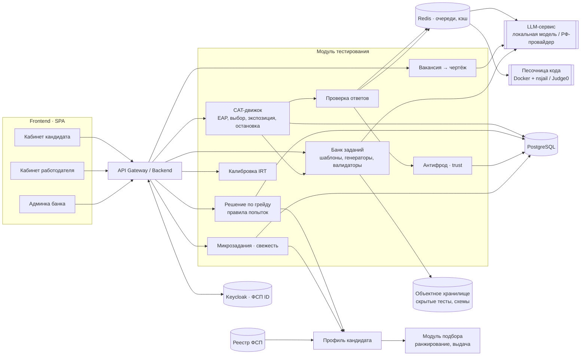
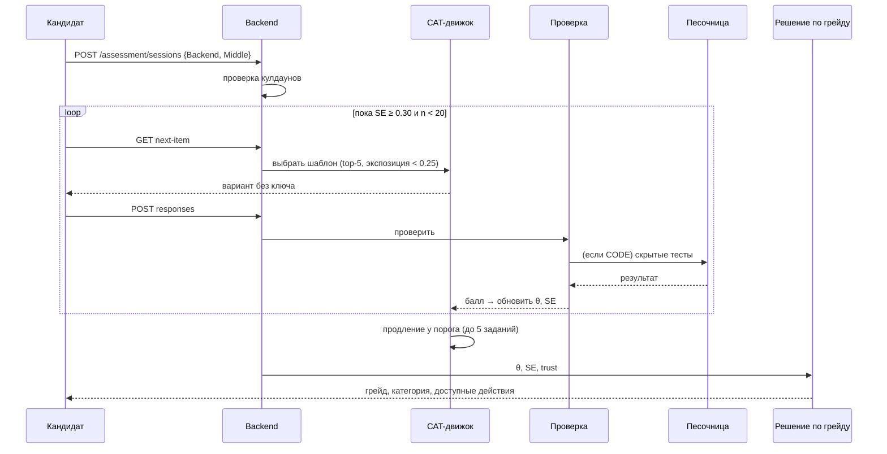

# Модуль тестирования кандидатов · платформа подбора ИТ-специалистов (спецтрек ФСП)

Модуль определяет грейд кандидата (Junior / Middle / Senior) по специализации, присваивает категорию «специализация × грейд», которую видит работодатель, и поддерживает актуальность профиля с помощью микрозаданий.

Основа механики: **параметризованные шаблоны заданий + калибровка по IRT 2PL + адаптивный тест (CAT) + ограничение экспозиции 0,25**. Подробное ТЗ: `Механика_тестирования_ТЗ_и_банк_заданий.md`.

---

## Содержание

1. [Функциональность](#1-функциональность)
2. [Архитектура и связи](#2-архитектура-и-связи)
3. [Сквозные сценарии](#3-сквозные-сценарии)
4. [Интеграции](#4-интеграции)
5. [Структура репозитория](#5-структура-репозитория)
6. [Стек](#6-стек)
7. [Запуск](#7-запуск)
8. [Конфигурация](#8-конфигурация)
9. [API](#9-api)
10. [Банк заданий](#10-банк-заданий)
11. [Валидация](#11-валидация)
12. [Безопасность и 152-ФЗ](#12-безопасность-и-152-фз)
13. [Статус и дорожная карта](#13-статус-и-дорожная-карта)

---

## 1. Функциональность

### Кандидат
| Функция | Описание |
|---|---|
| Онбординг | Опрос: отрасль, специализация, стек, стаж. Самовыбор грейда с описанием ожиданий |
| Базовый тест | Адаптивная теория + код + отладка/ревью + кейс (по грейду). 40–90 минут |
| Решение по грейду | Пройден / уверенно выше (тест на грейд выше) / пограничный / не пройден (тест на грейд ниже). Принудительного понижения нет |
| Ограничения | Смена грейда — раз в 90 дней; повтор на тот же грейд — через 30 дней; одна активная сессия |
| Результат | Грейд, процентиль в категории, профиль навыков по тегам, история попыток, даты доступных действий |
| Микрозадания | Раз в 14 дней, 10–15 минут, обновляют свежесть профиля |
| Профильный модуль | Короткий тест под вакансию, даёт «соответствие вакансии», грейд не меняет |

### Работодатель
| Функция | Описание |
|---|---|
| Потребность → навыки | Текст вакансии → теги навыков с весами и целевой грейд (редактируемые) |
| Профильный чертёж | Предпросмотр состава теста и примеров заданий под вакансию |
| Результаты кандидата | Грейд, дата, процентиль, профиль навыков, свежесть, доверие, ФСП. Контакты скрыты до принятия приглашения |
| Микрозадания | Своё задание с рубрикой или из банка; решения видны обезличенно |

### Контент-администратор
| Функция | Описание |
|---|---|
| Шаблоны | Создание, предпросмотр сгенерированных вариантов, результаты валидаторов |
| Калибровка | Запуск пересчёта a, b; отчёт об изменениях |
| Мониторинг | Экспозиция, доля верных ответов против ожидаемой, дрейф, карантин |

---

## 2. Архитектура и связи

Модульный монолит с явными границами модулей. Песочница кода и LLM-оценка вынесены в отдельные воркеры, потому что они медленные и изолированные.



### Кто от кого зависит

| Модуль | Получает | Отдаёт |
|---|---|---|
| Банк заданий | Шаблоны (bank.json / админка), LLM для перефразирования | Готовые проверенные варианты |
| CAT-движок | Варианты из банка, ответы, параметры a/b, счётчики экспозиции | Следующее задание, θ и SE |
| Проверка ответов | Ответ, ключ варианта | Балл; задания на код — в песочницу, кейсы — в LLM |
| Антифрод | События клиента, время, решения, person-fit | Сигналы и trust |
| Решение по грейду | θ, SE, trust, история попыток | Грейд, кулдауны, запись в историю |
| Вакансия → чертёж | Текст потребности | Теги с весами, профильный чертёж |
| Микрозадания | Категория кандидата, задания работодателей | Свежесть, последняя активность |
| Калибровка | Накопленные ответы | Новые a, b, карантин |
| Профиль кандидата | Грейд, процентиль, навыки, свежесть, trust, ФСП | Данные для подбора |
| Подбор (вне модуля) | Профиль, потребность работодателя | Ранжированная выдача с объяснением |

Граница с модулем подбора — **только через профиль кандидата**: тестирование ничего не знает о приглашениях и откликах, подбор не знает об устройстве теста.

---

## 3. Сквозные сценарии

### Базовый тест


### Вакансия → тест
1. Работодатель: `POST /employer/needs` с текстом.
2. LLM с JSON-схемой по справочнику тегов возвращает навыки и грейд; словарь синонимов — запасной путь.
3. Чертёж: квоты тем смещаются к тегам вакансии.
4. Кандидат проходит профильный модуль (λ = 0,5) → «соответствие вакансии» попадает в профиль и в объяснение выдачи.

### Жизненный цикл шаблона
`draft → calibrating → active → quarantine → retired`. Карантин включается автоматически при дрейфе (CUSUM) или вручную.

---

## 4. Интеграции

| Система | Направление | Как | В MVP |
|---|---|---|---|
| **ФСП ID (Keycloak)** | вход | OIDC: Authorization Code + PKCE; роли из realm roles; привязка `fsp_id` к профилю | Да, через локальный Keycloak; можно заменить на e-mail + JWT |
| **Реестр ФСП** | вход | Синхронизация достижений по `fsp_id` (адаптер с заглушкой, моковые данные). Если истории нет — компонент ФСП исключается из ранжирования | Мок |
| **LLM** | исход. | HTTP к OpenAI-совместимому API (vLLM / Ollama локально или российский провайдер). Задачи: перефразирование, извлечение навыков, оценка кейсов. ПДн не передаются | Да |
| **Песочница кода** | исход. | Очередь в Redis → воркер запускает контейнер без сети с лимитами; альтернатива — Judge0 | Да (Python, JS) |
| **Модуль подбора** | исход. | Чтение профиля кандидата (грейд, θ-процентиль, навыки, свежесть, trust) | Да |
| **ATS работодателя** | исход. | Вебхук `candidate.assessment.completed` + выгрузка сводки по API | Концепция |
| **Почта** | исход. | SMTP: подтверждение e-mail, напоминания о микрозаданиях и кулдаунах | Да |
| **Мониторинг** | исход. | Prometheus-метрики + логи | Базово |

### События (внутренняя шина / вебхуки)
| Событие | Кто слушает |
|---|---|
| `assessment.session.completed` | Профиль, подбор (пересчёт ранжирования), ATS |
| `candidate.grade.changed` | Профиль, уведомления |
| `item.template.quarantined` | Админка, мониторинг |
| `microtask.submitted` | Профиль (свежесть), работодатель |

---

## 5. Структура репозитория

```
assessment/
├── README.md
├── docker-compose.yml
├── .env.example
├── docs/
│   ├── Механика_тестирования_ТЗ_и_банк_заданий.md
│   └── openapi.yaml
├── data/
│   └── bank.json                 # шаблоны, теория, расширение, микрозадания, вакансии
├── backend/
│   ├── app/
│   │   ├── api/                  # роутеры FastAPI: candidate, employer, admin
│   │   ├── auth/                 # OIDC / Keycloak
│   │   ├── bank/                 # модели шаблонов, генераторы, валидаторы, загрузка bank.json
│   │   ├── cat/                  # IRT 2PL, EAP, выбор задания, экспозиция, остановка
│   │   ├── grading/              # решение по грейду, кулдауны, история
│   │   ├── scoring/              # MCQ/SHORT, DEBUG/REVIEW, постановка в очереди
│   │   ├── fraud/                # сигналы, person-fit, trust
│   │   ├── vacancy/              # извлечение навыков, профильный чертёж
│   │   ├── microtasks/           # назначение, свежесть
│   │   ├── calibration/          # MML, дрейф, карантин
│   │   ├── integrations/         # llm, sandbox, fsp, ats
│   │   └── db/                   # SQLAlchemy-модели, миграции Alembic
│   └── tests/
├── workers/
│   ├── sandbox/                  # запуск кода
│   └── llm_grader/               # оценка кейсов по рубрике
├── frontend/                     # SPA: кандидат, работодатель, админка
└── scripts/
    ├── load_bank.py              # bank.json → БД
    ├── generate_instances.py     # пополнение пулов вариантов
    └── sim.py                    # симуляционная валидация
```

---

## 6. Стек

| Слой | Выбор | Зачем |
|---|---|---|
| Backend | Python 3.12, FastAPI, Pydantic v2, SQLAlchemy 2, Alembic | Один язык с CAT/IRT и ML-частью |
| Расчёты | NumPy (EAP, информация), SciPy | CAT ~300 строк, без тяжёлых зависимостей |
| БД | PostgreSQL 16 | jsonb для параметров и рубрик |
| Очереди, кэш | Redis 7 + RQ / Celery | Песочница и LLM асинхронно |
| Песочница | Docker + nsjail (или Judge0) | Изоляция, лимиты, без сети |
| LLM | OpenAI-совместимый API: vLLM / Ollama локально | 152-ФЗ, без передачи ПДн наружу |
| Авторизация | Keycloak (OIDC) | Совместимость с будущим ФСП ID |
| Frontend | React + TypeScript, Vite, TanStack Query, Monaco Editor | Редактор кода в тесте |
| Инфраструктура | Docker Compose, GitHub Actions / GitLab CI | Запуск одной командой |

Точные версии библиотек фиксируются в `requirements.txt` и `package-lock.json` и переносятся в документацию при сдаче.

---

## 7. Запуск

```bash
git clone <repo> && cd assessment
cp .env.example .env
docker compose up -d --build          # postgres, redis, keycloak, backend, workers, frontend
docker compose exec backend alembic upgrade head
docker compose exec backend python scripts/load_bank.py data/bank.json
docker compose exec backend python scripts/generate_instances.py --per-template 50
```

| Сервис | Адрес |
|---|---|
| Frontend | http://localhost:5173 |
| API + Swagger | http://localhost:8000/docs |
| Keycloak | http://localhost:8080 (realm `fsp`, тестовые пользователи в `.env.example`) |

Без Docker: `pip install -r backend/requirements.txt && uvicorn app.main:app --reload` (нужны PostgreSQL и Redis).

Тесты: `docker compose exec backend pytest`.

---

## 8. Конфигурация

| Переменная | По умолчанию | Назначение |
|---|---|---|
| `DATABASE_URL` | `postgresql://…/assessment` | БД |
| `REDIS_URL` | `redis://redis:6379/0` | Очереди и кэш |
| `OIDC_ISSUER`, `OIDC_CLIENT_ID` | локальный Keycloak | Авторизация |
| `LLM_BASE_URL`, `LLM_MODEL` | `http://ollama:11434/v1` | LLM |
| `SANDBOX_MODE` | `nsjail` | `nsjail` или `judge0` |
| `SANDBOX_TIMEOUT_SEC`, `SANDBOX_MEM_MB` | `5`, `256` | Лимиты |
| `CAT_SE_STOP`, `CAT_MIN_ITEMS`, `CAT_MAX_ITEMS` | `0.30`, `8`, `20` | Остановка CAT (`0.35` — короче тест) |
| `CAT_TOPK` | `5` | Случайный выбор из top-k |
| `EXPOSURE_CAP`, `EXPOSURE_WINDOW_DAYS` | `0.25`, `30` | Ограничение показа шаблона |
| `GRADE_CUTS` | `-1.2,0.2,1.2` | Пороги Junior / Middle / Senior |
| `GRADE_CHANGE_COOLDOWN_DAYS`, `RETRY_COOLDOWN_DAYS` | `90`, `30` | Ограничения попыток |
| `TRUST_THRESHOLD` | `0.6` | Порог подтверждающего теста |
| `FRESHNESS_HALF_LIFE_DAYS` | `90` | Затухание свежести |

---

## 9. API

OpenAPI 3.1 в `docs/openapi.yaml`, Swagger на `/docs`. Префикс `/api/v1`, Bearer JWT.

| Группа | Методы |
|---|---|
| Каталог | `GET /catalog/specializations` |
| Онбординг | `POST /onboarding/survey` |
| Тест | `GET /assessment/eligibility` · `POST /assessment/sessions` · `GET /assessment/sessions/{id}` · `GET …/next-item` · `POST …/responses` · `POST …/code-runs` · `POST …/finish` · `GET …/result` |
| История | `GET /candidates/me/grade-history` |
| Микрозадания | `GET /micro-tasks/inbox` · `POST /micro-tasks/{id}/submit` · `POST /employer/micro-tasks` |
| Вакансии | `POST /employer/needs` · `PATCH /employer/needs/{id}` · `GET /employer/needs/{id}/blueprint` |
| Работодатель | `GET /employer/candidates/{id}/assessment` |
| Админка | `POST /admin/item-templates` · `POST …/{id}/instances:generate` · `POST …/{id}:quarantine` · `POST /admin/calibration-runs` · `GET …/{id}/stats` |

Ошибки: `409 COOLDOWN_ACTIVE`, `409 SESSION_ALREADY_ACTIVE`, `409 ITEM_ALREADY_ANSWERED`, `410 SESSION_EXPIRED`, `408 ITEM_TIME_EXCEEDED`, `422 VALIDATION_ERROR`, `429 CODE_RUN_LIMIT`, `403 FORBIDDEN`.

---

## 10. Банк заданий

`data/bank.json`:

| Раздел | Что внутри | Объём |
|---|---|---|
| `templates` | Детальные шаблоны: условие, параметры, эталон, оценивание, рубрика, пример | 60 |
| `theory_templates` | Короткие теоретические шаблоны | 48 |
| `extension_templates` | Шаблоны расширения | 180 |
| `micro_tasks` | Микрозадания | 8 |
| `vacancies` | Примеры вакансий с навыками и чертежами | 4 |

Итого **72 шаблона на специализацию** (Backend, Frontend, QA, DevOps), 7 форматов: MCQ, MSQ, SHORT, CODE, DEBUG, REVIEW, CASE.

Добавление шаблона: запись в `bank.json` или через админку → генератор в `backend/app/bank/generators/<id>.py` → `generate_instances.py` → проверка валидаторами → статус `calibrating`.

---

## 11. Валидация

```bash
python scripts/sim.py data/bank.json      # ~2 минуты → sim_results.json
```

2000 синтетических кандидатов на специализацию, каждый проходит тест дважды. Результаты на расширенном банке:

| Метрика | Значение | Цель |
|---|---|---|
| Точность грейда | 84–86 % | ≥ 80 % |
| Ошибка больше чем на один грейд | 0 % | 0 % |
| Тот же грейд при повторе (вне пограничной зоны) | 87–91 % | ≥ 85 % |
| Корреляция оценки с истинным уровнем | 0,96–0,97 | ≥ 0,9 |
| Максимальная экспозиция шаблона | 0,25 | ≤ 0,25 |
| Сдвиг оценки при утечке 20 % банка | +0,07…+0,10 (фиксированные задания: +0,34…+0,46) | ≤ 0,1 |

Это симуляция на стартовых параметрах; подтверждается пилотом и экспертной разметкой (раздел 17 ТЗ). Скрипт запускается в CI: точность < 75 % или экспозиция > 0,25 блокируют слияние.

---

## 12. Безопасность и 152-ФЗ

- Ключи ответов и скрытые тесты хранятся отдельно и доступны только сервису проверки.
- Песочница без сети, с лимитами CPU, памяти и времени, ФС только для чтения.
- Ролевая модель: candidate, employer, content_admin, service; кандидат видит только свои сессии, работодатель — обезличенную сводку до принятия приглашения.
- Согласие на обработку и публикацию результатов; данные в РФ; удаление по запросу.
- В LLM уходят только обезличенные тексты ответов.
- Пароли — только в Keycloak; токены короткоживущие; журнал действий администратора.

---

## 13. Статус и дорожная карта

| Приоритет | Что | Статус |
|---|---|---|
| P0 | Банк и генераторы, CAT-движок, песочница, экраны теста и результата, решение по грейду, sim.py | MVP |
| P1 | LLM-оценка кейсов, вакансия → чертёж, микрозадания | MVP, упрощённо |
| P2 | Антифрод и trust, онлайн-рекалибровка и дрейф, админка | Базово / концепция |
| После MVP | Модель GPCM для частичных баллов, Sympson–Hetter, интеграция с ATS, реальный реестр ФСП | Концепция |
